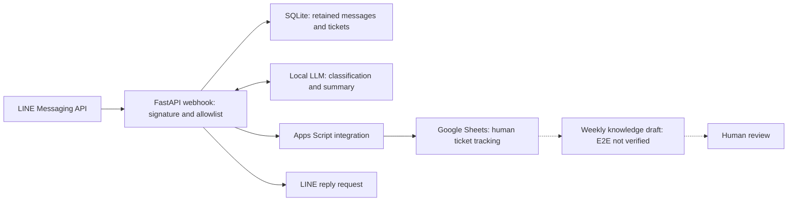

# LINE ITSM AI Bot

**AI-Assisted IT Service Workflow Automation**

An internal pilot connecting LINE Messaging API, FastAPI, and a local LLM to classify new IT issues and create tickets. SQLite retains messages and tickets; Apps Script integrates with Google Sheets for human tracking.

**Status:** Internal operating records exist; no formal Production acceptance is claimed. Weekly knowledge consolidation remains unverified end to end.

此案例著重訊息語境、工單流程與可靠性邊界，而非 AI 自動處理系統故障。AI 協助分類與撰寫草稿，處理與發布仍由人員決定。

## Engineering Highlights

- **51 messages and 22 tickets** in archived records for 2026-10-06 through 2026-10-12; these are observed counts, not accuracy or time-saving metrics.
- **Webhook controls:** signature verification, an authorized-group allowlist, and event deduplication.
- **Context-aware triage:** recent conversation and IT-responder exclusion help distinguish a new issue from a reply; five archived scenario checks matched expectations.
- **Simple integration:** SQLite plus Apps Script and Google Sheets, with synchronization and concurrency controls implemented but incompletely tested under failure conditions.

## Architecture

The diagram describes logical workflow, not deployment endpoints. Sending a reply request is distinct from proving delivery. The weekly path is incomplete and must not be treated as an accepted service.

## Evidence and Limits

| Evidence | Supported observation | Limit |
|---|---|---|
| Archived operating records | 51 messages; 22 tickets | No classification accuracy, adoption, or saved-hours measurement |
| Local ticket synchronization state | All 22 tickets marked `synced=1` locally | No independent full reconciliation of the spreadsheet |
| Five context scenarios | Expected new-issue versus reply decisions recorded | Too small to establish an error rate |
| Six LLM failure events | Original messages were retained; classification and ticket creation did not complete | Not raw-message loss; recovery behavior remains unvalidated |
| Weekly knowledge workflow | Sample work exists; first scheduled attempt failed | No successful end-to-end acceptance |

Implemented spreadsheet resubmission, deduplication, locking, and concurrency controls are not equivalent to verified resilience. Exact operational details are withheld; no LINE reply delivery rate is claimed.

## My Contributions / AI-Assisted Engineering

**Project Owner:** defined the service workflow, selected the architecture and integration approach, handled required platform setup, and reviewed practical results and acceptance criteria.

**Claude Code:** implemented the recorded backend, prompts, Apps Script integration, container deployment, scheduling, and tests; diagnosed issues from operating records. The owner did not personally write most of the implementation.

**Codex:** prepared this documentation from the de-identified handoff without contacting LINE, the LLM service, or the spreadsheet.

## Documentation and Reproducibility

See the [Engineering Journey](docs/ENGINEERING_JOURNEY.md) for design decisions and failure analysis. This documentation-only candidate contains no source code, conversations, group identifiers, credentials, or deployment settings. Archived results cannot be reproduced from these files alone.
